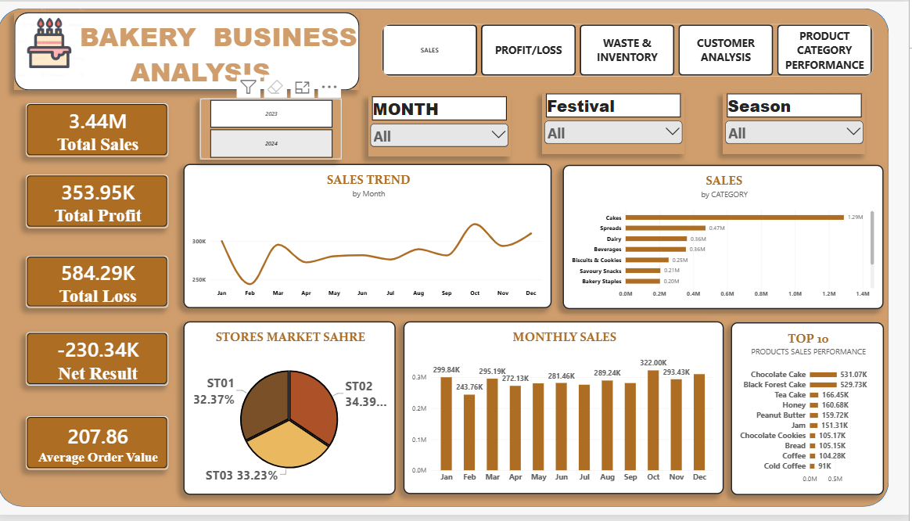
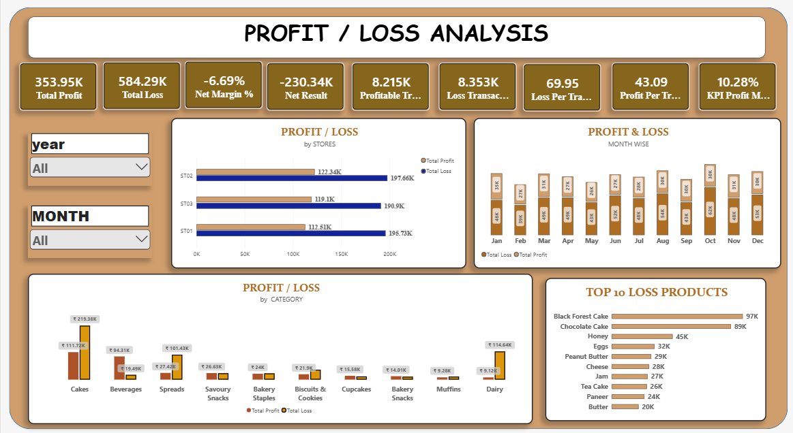
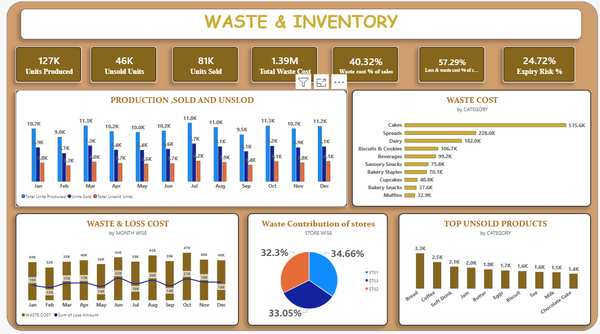
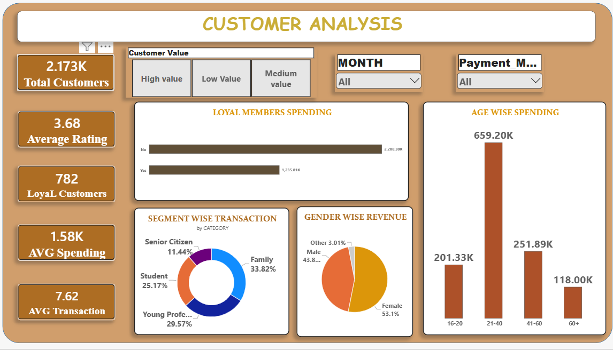
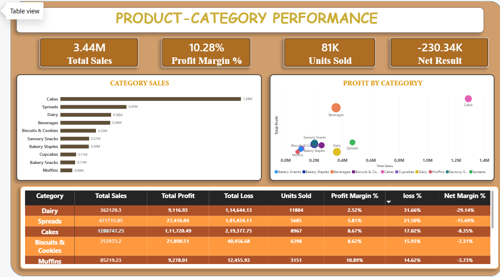

# Bakery Business Analysis Dashboard | Power BI

## Project Overview
An interactive Power BI dashboard developed to analyze bakery business performance across sales, profitability, customer behavior, product categories, and inventory waste. The project uses KPI reporting and data visualization to identify business losses and areas requiring improvement.

## Business Objectives
- Analyze total sales, profit, loss, and net financial performance.
- Identify product categories contributing to sales and losses.
- Evaluate waste costs, unsold inventory, and expiry risk.
- Understand customer spending, loyalty, and transaction behavior.
- Identify opportunities to improve profitability and operational efficiency.

## Tools & Technologies
- Microsoft Power BI
- DAX (Data Analysis Expressions)
- Data Modeling
- KPI Development
- Data Visualization
- Business Performance Analysis

## Key Performance Indicators

| KPI | Dashboard Value |
|---|---:|
| Total Sales | 3.44M |
| Total Profit | 353.95K |
| Total Loss | 584.29K |
| Net Result | -230.34K |
| Profit Margin | 10.28% |
| Units Sold | 81K |
| Units Produced | 127K |
| Unsold Units | 46K |
| Total Waste Cost | 1.39M |
| Total Customers | 2.173K |
| Average Customer Rating | 3.68 |
| Loyal Customers | 782 |

*Note: KPI values are based on the rounded figures displayed in the dashboard.*

## Key Business Insights

### 1. Overall Profitability
- The dashboard reports total profit of 353.95K and total loss of 584.29K.
- The net result is -230.34K, indicating that losses exceed profits.
- The displayed profit margin is 10.28%, while the overall net margin is -6.69%.

### 2. Product Category Performance
- Cakes generate the highest category sales at approximately 1.29M.
- The Cakes category also shows a substantial total loss of approximately 219.38K.
- High sales do not necessarily translate into strong net profitability.

### 3. Waste and Inventory
- The dashboard reports 127K units produced, 81K units sold, and 46K unsold units.
- Total waste cost is approximately 1.39M.
- The displayed expiry risk is 24.72%.
- These indicators highlight the importance of production planning and inventory control.

### 4. Products Contributing to Losses
- Black Forest Cake is the leading loss product, at approximately 97K.
- Chocolate Cake follows at approximately 89K.
- Honey contributes approximately 45K in losses.
- These products are potential priorities for further cost and profitability analysis.

### 5. Customer Analysis
- The dashboard reports approximately 2.173K customers and 782 loyal customers.
- The average customer rating is 3.68.
- Average spending is approximately 1.58K.
- Customer segmentation and spending analysis can help identify opportunities to improve retention and customer experience.

## Business Recommendations
- Investigate high-loss products and review their production costs and pricing.
- Improve demand forecasting to reduce unsold inventory.
- Monitor waste and expiry costs by category and month.
- Evaluate category-level profitability rather than relying on sales alone.
- Use customer spending and loyalty insights to improve retention strategies.

## Project Files
- `Bakery_sales_analysis.pbix` — Interactive Power BI dashboard.

## How to Explore the Project
1. Download the `.pbix` file from this repository.
2. Open it using Microsoft Power BI Desktop.
3. Explore the report pages and available filters to analyze sales, profitability, customers, products, and inventory.

## Author
**Lakshay**

GitHub: [lakshayda21](https://github.com/lakshayda21)
## Dashboard Screenshots

### 1. Sales Overview

### 2. Profit and Loss Analysis

### 3. Waste and Inventory

### 4. Customer Analysis

### 5. Product Category Performance

